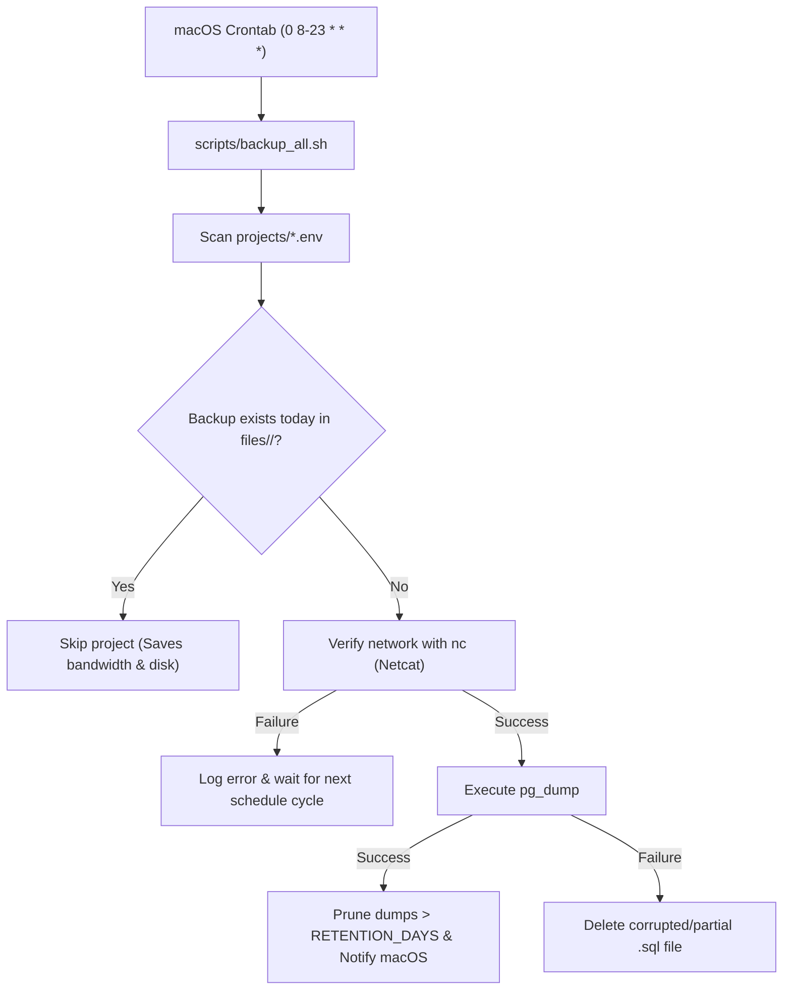

# 🗄️ Multi-Project Automated Supabase Backup (Smart Retry)

[](https://github.com/lfrichter/supabase-backup)
[](#)
[](#)
[](#)

A modular, resilient backup and retention automation system for multiple **Supabase (PostgreSQL)** databases featuring automatic retry logic (Smart Retry), daily duplication prevention, network connectivity shielding, and native macOS notifications.

---

## 🧭 Metadata & Overview

- **GitHub Repository:** [lfrichter/supabase-backup](https://github.com/lfrichter/supabase-backup)
- **Local Path:** `~/projects/side/supabase-backups` (`/Users/master/projects/side/supabase-backups`)
- **Active Projects:**
  - `canaoaves`: **Canaoaves** database (`ugbcqdrslppxgfqollvu`)
  - `forroja`: **ForroJá** database
  - Seamlessly expandable to new databases via independent `.env` configuration files.

---

## 🚀 Architecture & Workflow

The system is designed to be fully resilient against network drops, unstable connections, and machine downtime.



### 🧠 Intelligent Layer (Smart Retry)

1. **Isolated Multi-Projects:** Each project has its own dedicated configuration file in `projects/<project>.env`, and generated SQL dumps are stored separately in `files/<project>/`.
2. **Daily Duplication Prevention:** Before downloading a dump, the script checks `files/<project>/` to see if a completed backup already exists for today. If found, it skips that database immediately.
3. **Network Connectivity Shielding:** Tests the TCP connection to the Supabase host and port (`nc -z -w5 $DB_HOST $DB_PORT`) before invoking `pg_dump`.
4. **Automatic Failure Cleanup:** If a backup operation is interrupted or fails midway, the corrupted partial `.sql` file is deleted automatically, allowing the next cron cycle to start cleanly.
5. **Configurable Retention Policy:** Automatically purges outdated backups based on the `RETENTION_DAYS` variable configured in each `.env` (default: 15 days).
6. **Native macOS Notifications:** Sends notification banners to the macOS Notification Center detailing the backup status and final file size.

---

## 📂 Directory Structure

```text
supabase-backups/
├── projects/                        # Isolated project configuration files
│   ├── .env.example                 # Baseline environment template
│   ├── canaoaves.env                # Canaoaves project configuration
│   ├── forroja.env                  # ForroJá project configuration
│   ├── forroja.env.example          # Sample configuration template
│   └── ...                          # Additional project configs (.env)
│
├── scripts/
│   ├── backup_project.sh            # Script that executes backup for 1 target project
│   ├── backup_all.sh                # Master runner that loops through all projects
│   └── backup_semanal.sh            # Compatibility wrapper for legacy cron entries
│
├── files/                           # Target directory for dumps organized by project
│   ├── canaoaves/                   # Canaoaves dumps (e.g. backup_canaoaves_2026-09-25_08-00-00.sql)
│   ├── forroja/                     # ForroJá dumps
│   └── ...
│
├── backup.log                       # Consolidated execution logs
└── README.md                        # Project technical documentation
```

---

## ⏰ Scheduling on macOS (Cron)

The scheduled backup runs hourly during an extended operational window (from 08:00 to 23:00). Each project is checked individually: if today's backup is already completed, the check concludes in milliseconds.

```cron
0 8-23 * * * /bin/bash $HOME/projects/side/supabase-backups/scripts/backup_all.sh >> $HOME/projects/side/supabase-backups/backup.log 2>&1
```

> **Why this schedule window?**  
> If the computer is powered off or asleep at 08:00, the backup executes automatically during the first hour the machine wakes up (09:00, 10:00, etc.). Once successful for the day, subsequent runs instantly detect the existing backup and exit without consuming resources.

---

## 🛠️ Commands & Operations Guide

### Run backup for all projects
```bash
# From the project root:
./scripts/backup_all.sh

# Or using the absolute path:
~/projects/side/supabase-backups/scripts/backup_all.sh
```

### Run backup for a specific project
```bash
# By project name:
./scripts/backup_project.sh canaoaves

# Or by config file path:
./scripts/backup_project.sh projects/forroja.env
```

### Tail execution logs in real time
```bash
tail -f backup.log
# or
tail -f ~/projects/side/supabase-backups/backup.log
```

### Inspect current crontab schedule
```bash
crontab -l
```

---

## ➕ Adding a New Database / Project

To integrate a new Supabase database into the automated routine:

1. Duplicate the baseline template:
   ```bash
   cp projects/.env.example projects/new_project.env
   ```

2. Edit the file with the target Supabase credentials:
   ```env
   PROJECT_NAME="new_project"
   PROJECT_LABEL="New Project"

   DB_HOST="aws-0-sa-east-1.pooler.supabase.com"
   DB_PORT="6543"
   DB_NAME="postgres"
   DB_USER="postgres.your_project_ref"
   PGPASSWORD="your-strong-password"

   RETENTION_DAYS=15
   ```

3. Done! The master script (`backup_all.sh`) and cron will automatically detect and execute the new project on the next cycle.

---

## ⚠️ Security

- All `.env` files inside `projects/` and at the root are tracked in `.gitignore` to prevent credential leaks.
- All database dump `.sql` files inside `files/` are ignored in `.gitignore`.
