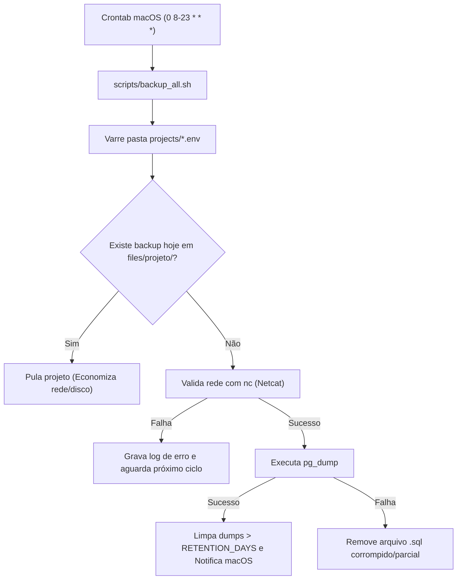

# 🗄️ Supabase Backup Automático Multi-Projetos (Smart Retry)

[](https://github.com/lfrichter/supabase-backup)
[](#)
[](#)
[](#)

Sistema modular e resiliente para realização de backups automatizados e retenção programada de múltiplos bancos de dados **Supabase (PostgreSQL)** com lógica de tentativa automática (Smart Retry), controle de duplicidade diária, blindagem de conectividade de rede e notificações no macOS.

---

## 🧭 Metadados e Informações Gerais

- **Repositório GitHub:** [lfrichter/supabase-backup](https://github.com/lfrichter/supabase-backup)
- **Local no Disco:** `~/projects/side/supabase-backups` (`/Users/master/projects/side/supabase-backups`)
- **Projetos Ativos:**
  - `canaoaves`: Banco do projeto **Canaoaves** (`ugbcqdrslppxgfqollvu`)
  - `forroja`: Banco do projeto **ForroJá**
  - Suporte expansível para novos bancos via arquivos de configuração `.env` independentes.

---

## 🚀 Arquitetura e Funcionamento

O sistema foi desenhado para ser resiliente a falhas de rede, oscilações de conexão e desligamento da máquina local.



### 🧠 Camada de Inteligência (Smart Retry)

1. **Multi-Projetos Isolados:** Cada projeto possui seu próprio arquivo `.env` em `projects/<projeto>.env` e os dumps gerados são salvos isoladamente em `files/<projeto>/`.
2. **Verificação de Duplicidade Diária:** Antes de iniciar o download de um banco, o script checa na pasta do projeto (`files/<projeto>/`) se já existe um backup concluído para o dia atual. Se sim, ele ignora aquele projeto e passa para o próximo.
3. **Blindagem de Conectividade:** Testa a conexão TCP na porta do Supabase (`nc -z -w5 $DB_HOST $DB_PORT`) antes de invocar o utilitário `pg_dump`.
4. **Auto-Limpeza de Falhas:** Caso o backup de um banco seja interrompido ou falhe, o arquivo parcial corrompido é removido automaticamente para permitir que a próxima tentativa do Cron execute sem deixar lixo.
5. **Política de Retenção:** Remove automaticamente backups antigos com base na variável `RETENTION_DAYS` configurada em cada `.env` (padrão: 15 dias).
6. **Notificações macOS:** Notifica o usuário na Central de Notificações do macOS com o status e tamanho do backup gerado.

---

## 📂 Estrutura do Diretório

```text
supabase-backups/
├── projects/                        # Configurações isoladas de cada projeto
│   ├── .env.example                 # Modelo base com as variáveis
│   ├── canaoaves.env                # Configurações do projeto Canaoaves
│   ├── forroja.env                  # Configurações do projeto ForroJá
│   ├── forroja.env.example          # Modelo para o projeto ForroJá
│   └── ...                          # Novos projetos (.env)
│
├── scripts/
│   ├── backup_project.sh            # Script que executa o backup de 1 projeto específico
│   ├── backup_all.sh                # Script mestre que executa o backup de todos os projetos
│   └── backup_semanal.sh            # Wrapper de compatibilidade com agendamentos anteriores
│
├── files/                           # Destino dos backups organizados por projeto
│   ├── canaoaves/                   # Backups do Canaoaves (ex: backup_canaoaves_2026-09-25_08-00-00.sql)
│   ├── forroja/                     # Backups do ForroJá
│   └── ...
│
├── backup.log                       # Logs de execução consolidados
└── README.md                        # Documentação técnica do projeto
```

---

## ⏰ Agendamento no macOS (Cron)

O agendamento executa de hora em hora na janela definida (das 08h às 23h). Cada projeto é verificado individualmente: se o backup do dia já tiver sido feito, ele é ignorado instantaneamente.

```cron
0 8-23 * * * /bin/bash $HOME/projects/side/supabase-backups/scripts/backup_all.sh >> $HOME/projects/side/supabase-backups/backup.log 2>&1
```

> **Por que essa janela?**
> Caso o notebook ou computador esteja desligado às 08:00, o backup será executado automaticamente na primeira hora em que o computador for ligado (09:00, 10:00, etc.). Assim que obtiver sucesso no dia, as tentativas subsequentes apenas verificam a duplicidade e encerram em frações de segundo.

---

## 🛠️ Guia de Comandos e Operações

### Executar Backup de Todos Os Projetos

```bash
# A partir da raiz do projeto:
./scripts/backup_all.sh

# Ou via caminho absoluto:
~/projects/side/supabase-backups/scripts/backup_all.sh
```

### Executar Backup de Apenas Um Projeto Específico

```bash
# Pelo nome do projeto:
./scripts/backup_project.sh canaoaves

# Ou pelo caminho do arquivo .env:
./scripts/backup_project.sh projects/forroja.env
```

### Monitorar Logs em Tempo Real

```bash
tail -f backup.log
# ou
tail -f ~/projects/side/supabase-backups/backup.log
```

### Verificar O Agendamento Atual no Cron

```bash
crontab -l
```

---

## ➕ Adicionando Um Novo Banco / Projeto

Para integrar um novo banco de dados Supabase na rotina:

1. Crie um arquivo em `projects/<nome_do_projeto>.env` (você pode duplicar o `projects/.env.example`):

   ```bash
   cp projects/.env.example projects/novo_projeto.env
   ```

2. Edite o arquivo com as credenciais do banco Supabase do projeto:

   ```env
   PROJECT_NAME="novo_projeto"
   PROJECT_LABEL="Novo Projeto"

   DB_HOST="aws-0-sa-east-1.pooler.supabase.com"
   DB_PORT="6543"
   DB_NAME="postgres"
   DB_USER="postgres.seu_project_ref"
   PGPASSWORD="sua-senha-aqui"

   RETENTION_DAYS=15
   ```

3. Pronto! O script mestre (`backup_all.sh`) e o Cron detectarão automaticamente o novo projeto na próxima execução.

---

## ⚠️ Segurança

- Todos os arquivos `.env` dentro de `projects/` e na raiz estão no `.gitignore` para não expor credenciais.
- Todos os arquivos de dump `.sql` dentro de `files/` estão no `.gitignore`.
